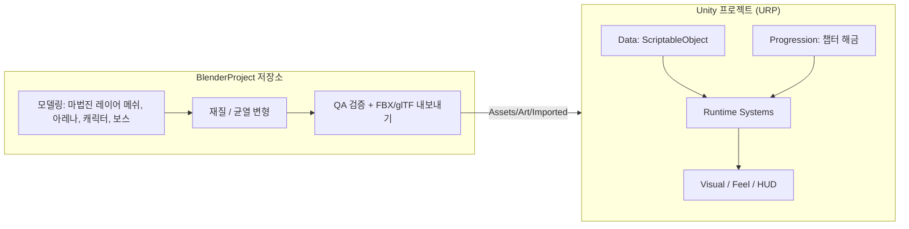
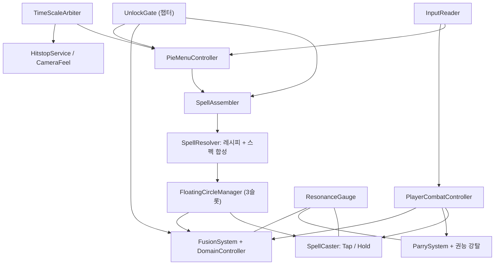
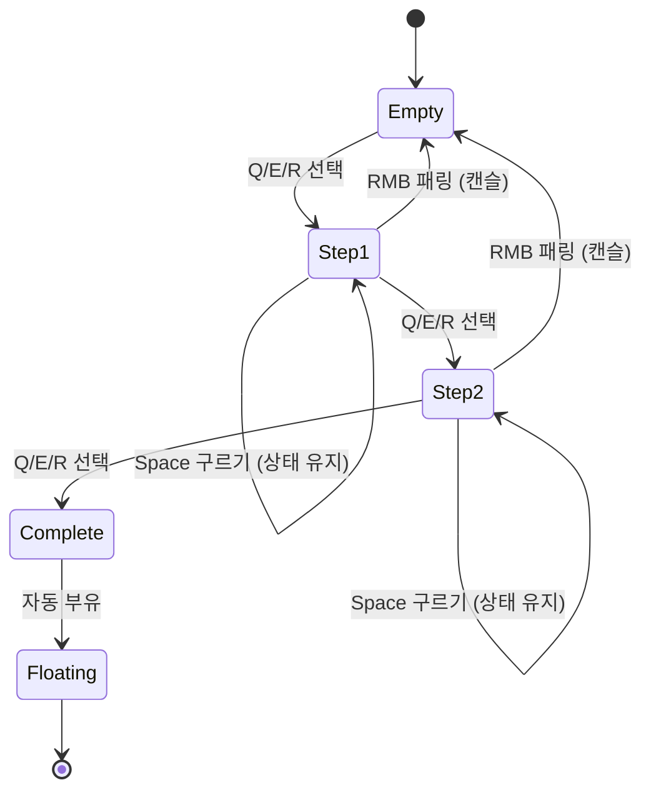

> [!CAUTION]
> 이 설계안은 AI와 함께 작성된 기획 자료를 바탕으로 한 초안입니다. 수치, 규칙, 용어에 오류나 모순이 있을 수 있으므로 구현 전에 검토가 필요합니다.
> 엔진은 Unity 대신 **웹 프로토타입(Three.js + TypeScript)** 으로 바뀌었습니다. 본문의 Unity 전용 항목(ScriptableObject, URP, New Input System)은 웹 환경에 맞게 다시 설계할 예정입니다.

# 구현 설계안 — 마법진 조립 실시간 액션 RPG

**참조 문서**
- [개정판] 스토리·세계관 개발 인수인계서 (Google Docs) → 서사, 용어, 챕터별 해금, 보스
- [code_artifact_1.md](file:///home/antigravity/upload/code_artifact_1.md) → 시스템 기획 (입력, 4-Layer, 자원, 연출, HUD)

> [!IMPORTANT]
> 시스템 기획서는 **Unity (URP + New Input System + ScriptableObject)** 를 전제로 작성되어 있지만, 현재 저장소 [BlenderProject](file:///home/antigravity/food2love3-dev/BlenderProject)에는 Blender 에셋(`blend/`, `scripts/`, CI)만 들어 있습니다. 그래서 이 설계안은 일을 이렇게 나눕니다. **게임 런타임은 Unity에서**, **3D 에셋 제작은 이 저장소의 Blender 파이프라인에서** 맡습니다.

---

## 1. 전체 아키텍처



### 런타임 모듈 의존 관계



---

## 2. Unity 프로젝트 구조

```
Assets/_Project/
  Scripts/
    Core/        PrototypeBootstrapper, GameServices, TimeScaleArbiter, EventBus
    Input/       InputReader (New Input System 래퍼), MouseDeltaAccumulator
    Player/      PlayerMotor, LockOnController, DodgeController, PotionController
    Spell/
      Data/      FrameSO, RuneSO, CoreSO, ShardSO, RecipeSO, FusionThemeSO
      Assembly/  SpellAssembler, AssemblyState, SlotBreakRules
      Resolve/   SpellResolver, SpellSpec, Delivery/* , Effects/*
      Runtime/   FloatingCircle, FloatingCircleManager, SpellCaster
    Combat/      ResonanceGauge, ParrySystem, StolenShardInventory, FusionSystem, Damage
    Domain/      DomainController (스카이박스/조명/안개/바닥 블렌드)
    Enemy/       BossBrain, BossPhaseSO, AttackPatternSO, MobSpawner
    Feel/        HitstopService, CameraFeel (Cinemachine Impulse/FOV), ProceduralAudio
    Visual/      AstrolabeTextureGenerator, CircleLayerRenderer, CrackController
    UI/          HUD (UI Toolkit), PieMenuView, DebugPanel(F1)
    Progression/ ChapterUnlockSO, UnlockGate, SaveData
    Narrative/   TermTable(확정 용어), DialogueRunner (후순위)
  Data/          *.asset (파츠 21종, 레시피 9, 융합 테마 9, 챕터 5, 보스 6)
  Art/Imported/  Blender에서 내보낸 FBX/glTF
```

---

## 3. 핵심 시스템 설계

### 3-1. 입력 & 전술 감속
- **`InputReader`**: Input Action Asset을 C# 이벤트로 감쌉니다 (`OnPieHold(PieKey)`, `OnPieRelease`, `OnFireTap/Hold`, `OnParry`, `OnFuse`, `OnSlotSelect(int)` 등). 게임플레이 코드는 Input System을 직접 참조하지 않습니다.
- **`TimeScaleArbiter`**: `timeScale`을 바꾸고 싶은 요청이 여러 군데서 동시에 들어오므로(파이 메뉴 0.25, 히트스톱 0, 일시정지 0) **요청 스택에서 최솟값을 고르는 방식**으로 중재합니다. `fixedDeltaTime`도 같은 비율로 맞춥니다.
- **파이 메뉴**: 커서는 잠근 채로 두고 `MouseDeltaAccumulator`가 **unscaled** 델타를 쌓습니다. 데드존을 넘으면 `atan2` 값으로 섹터를 바로 스냅하고, 키를 떼는 순간 선택을 확정합니다. 카메라와 UI는 전부 `unscaledDeltaTime`을 씁니다.
- C 메뉴에서는 강탈한 파편이 있을 때만 **Center Slot**이 열립니다. 데드존 안에서 키를 떼면 Center Slot이 선택됩니다.

### 3-2. 마법진 조립 (4-Layer + 틀 깨기)
레이어를 고정 필드 대신 **리스트로 표현**하면 `E→E→E`나 `R→E→R` 같은 틀 깨기를 별도 처리 없이 담을 수 있습니다.

```csharp
enum LayerKind { Frame, Rune, Core, Shard }
class AssemblyState { List<SpellPartSO> steps; ShardSO shard; }   // steps는 최대 3개
```



- **`SlotBreakRules`**: 1~3장에서는 각 종류(Q/E/R)를 1개씩만 허용하고, 이미 고른 종류의 키는 파이 메뉴를 열지 않습니다. 4장부터 `UnlockGate.SlotBreak`가 켜지면 중복 입력과 비정석 조합을 허용합니다.
- 원소 약공격: Rune 하나만 올린 1단계 상태에서 LMB를 누르면 발동합니다.

### 3-3. 스펙 합성 (`SpellResolver`)
완성된 레이어를 **`SpellSpec`** 으로 합칩니다. 전략 패턴과 데코레이터 패턴을 씁니다.

| 레이어 | 역할 | 구현 |
|---|---|---|
| Core | 발사 형태 | `IDelivery` 전략: Arrow(투사체), Vortex(장판), Eye(관통 광선), Star(낙하 / Hold 시 즉발) |
| Frame | 수치 보정 | `StatModifier[]`: 지속↑ / 위력·관통↑ / 경직치↑ / 다단 연사 |
| Rune | 유틸리티 효과 | `IHitEffect`: 화상 DoT, 동결 누적, 체인, 자세 붕괴, 탄속↑, 회복+투사체 소멸, 흡혈 |
| Shard | 성질 변조 | `IDelivery` 데코레이터: 성좌(공전 분열), 영역(결계), 붕괴(지연 연쇄), 중력(흡인), 시간(잔상 재발동), 공허(순간 직격) |

- **옛 문장 레시피**: `RecipeSO`는 `(Frame, Rune, Core)` 정렬 키로 Dictionary를 조회합니다. 일치하면 스펙을 덮어쓰고 각인 텍스처와 고유 VFX를 붙입니다. 2장 해금 후에만 적용됩니다.
- **틀 깨기 스펙**: 같은 Rune이 중복되면 효과를 중첩 강화합니다. Core가 2개면 Delivery 두 개를 동시에 발사합니다. Frame이 없으면 대신 불안정 페널티(반동이나 자기 피해)를 줍니다. 이 수치는 데이터로 조정할 수 있게 둡니다.

### 3-4. 부유 마법진
- `FloatingCircleManager`: 슬롯 3개(장별로 1→2→3 확장). 측후방 앵커를 Critically-damped spring으로 따라가며, `1/2/3` 키로 활성 슬롯을 고릅니다.
- 피격 판정: 1회 피격 시 `CrackController`로 균열 셰이더를 켜고, 누적 2회 또는 강공격 1회면 해당 마법진을 파괴합니다.
- 발사: 마법진이 타깃 쪽으로 정렬(약 0.08초) → 킥 반동 → 사출. Hold 압축은 공명 -20%를 쓰고 영창을 생략합니다.

### 3-5. 공명 게이지 / 패링 / 권능 강탈
- `ResonanceGauge` (0~100): 획득과 소모를 하나의 API(`TryConsume`, `Gain`)로 처리하고, 수치는 전부 `ResonanceConfigSO`에서 읽습니다.
- **패링 판정**: 공격마다 `impactTime`을 갖습니다. RMB를 누른 시각과의 차이 Δt로 판정합니다.
  - |Δt| ≤ Perfect(약 60ms): +40%, 히트스톱 90ms
  - ≤ Good(약 150ms): 정밀도에 따라 +20~40% 보간, 히트스톱 40~60ms
  - 범위 밖: **판정 없음**. 피해 100%, 게이지 획득 0, 부분 가드 없음
- 공격 데이터에 `stealable` 플래그(회피 불가 광역 패턴)가 있으면, 패링 성공 시 `StolenShardInventory`에 1회용 파편이 쌓입니다. 다음 C 메뉴의 Center Slot에서 비용 0으로 장착합니다.

### 3-6. 융합 & 전장 개변
- F 키 입력 시 부유 마법진 수와 해금 상태를 확인합니다. 2개면 -60%, 3개면 -100%(3번째는 촉매)입니다.
- `FusionThemeSO`: Rune 쌍(예: 빛+어둠 = 창세와 종언의 일식) → 융합 스펙, 스카이박스, URP Volume 프로필, 조명/안개 값, 바닥 텍스처, 지속 시간. 일치하는 테마가 없으면 범용 융합으로 처리합니다.
- `DomainController`: Volume weight를 블렌드하고 조명과 안개를 보간한 뒤, 지속 시간이 끝나면 원래 상태로 되돌립니다.

### 3-7. 챕터 해금 게이트 (스토리 문서 연동)

| 챕터 | `ChapterUnlockSO` 플래그 | 보스 (`BossSO`) |
|---|---|---|
| 1 | Q/E/R, 약공격, 패링, 부유 1슬롯 | 학회의 문지기 |
| 2 | + 옛 문장 레시피 | 옛 문장의 파수꾼 |
| 3 | + 부유 2슬롯, 2중 융합, 전장 개변 | 꺼지지 않는 불꽃 (단일 속성 무효 → 융합 강제) |
| 4 | + 틀 깨기, C 키 외신의 파편 6종, 권능 강탈 | 경계를 먹는 짐승 (정상 마법·2중 융합 무효), 초대 대마법사 |
| 5 | + 부유 3슬롯, 극초월 마력 융합 | 이치를 삼키는 공허 (3페이즈, 2페이즈 UI 노이즈) |

- 보스의 무효화 규칙은 `DamageImmunityRule`(예: "융합이 아닌 스펙 무효")로 데이터화하면, 시스템 설계와 서사가 같은 데이터를 공유합니다.
- 5장 2페이즈의 **HUD 노이즈** 연출과 레나의 바깥 고리 구원 이벤트는 `HUD.SetCorruption(0..1)`과 컷인 이벤트로 연결합니다.
- **용어 통일**: UI와 대사 문자열은 전부 `TermTable`(확정 서사 용어)을 거쳐 출력합니다. 에디터 검증 스크립트가 "외곽 프레임"이나 "슬롯" 같은 금지어가 노출되는지 검사합니다.

### 3-8. 비주얼 / 타격감 / HUD
- **`AstrolabeTextureGenerator`**: `Texture2D` 1024² 텍스처를 절차적으로 그립니다. 선 굵기 0.8~2.5px, 72분할 눈금, 룬 띠, 광물 안료 팔레트를 쓰고 Bloom은 최소한으로 둡니다. 결과는 파츠 조합 키로 캐시합니다.
- 레이어별 메쉬(Blender 제작)를 Z축으로 띄워 두고 서로 역회전시킵니다. 틀 깨기일 때는 오프셋과 기울기를 비대칭으로 바꿉니다.
- 히트스톱은 `TimeScaleArbiter`에 0을 요청해 걸고, unscaled 코루틴으로 풉니다. FOV 수축과 카메라 흔들림은 Cinemachine Impulse로 처리합니다.
- **HUD**: UI Toolkit으로 만듭니다. 상단 중앙에 보스 체력 바(지연 트레일 포함), 좌하단에 체력/공명(-20/-60/-100 눈금)/물약/슬롯을 둡니다. `F1` 디버그 패널에서 보스전/잡몹 전환, 씬 리셋, **챕터 강제 해금**을 할 수 있습니다.

### 3-9. `PrototypeBootstrapper`
빈 씬에서 실행하면 GameServices, 아레나(원형 바닥과 기둥), 조명과 Volume, 플레이어와 카메라 리그, 보스, HUD를 코드로 생성합니다. Blender 에셋이 아직 없으면 프리미티브로 대체합니다.

---

## 4. Blender 에셋 파이프라인 (이 저장소)

AGENTS.md의 순서(Scene 분석 → 모델링 → 재질 → 카메라 → 조명 → QA)와 서브에이전트 역할 분담을 그대로 따릅니다.

| 에셋 | 담당 | 비고 |
|---|---|---|
| 마법진 레이어 메쉬 (고리 4형태, 룬 띠, 코어 4형태, 파편 6형태) | blender_modeler | 얇은 링 메쉬, 0~1 UV, 균열 버전(Voronoi 분할 조각) |
| 1장 아레나 (학회 관문 유적) 블록아웃 | blender_modeler | 이후 챕터별로 확장 |
| 아벨 / 레나 / 보스 블록아웃 | blender_modeler | 리깅은 후순위 |
| 서사 소품: 교과서(1페이지만 낡음), 분필 동그라미 데칼, 찻잔 | modeler + material | 엔딩과 거점 연출용 |
| 광물 안료 재질 라이브러리 | blender_material | 적동, 서리청, 백금, 황토, 흑요석 |
| 프리뷰 카메라 / 조명 | blender_camera / blender_lighting | 에셋 검수 렌더용 |
| 검증 + 내보내기 | blender_qa | 이름 규칙, 스케일 1, 적용된 트랜스폼, 폴리곤 예산 확인 후 `export/*.fbx` |

- 스크립트 구성(기존 `scripts/` 방식 유지): `scripts/magic_circle/model_layers.py`, `materials.py`, `verify.py`, `export_fbx.py`. 기존 desk 오브젝트와 파일은 건드리지 않습니다.
- 기존 CI(`.github/workflows/blender-ci.yml`)에 신규 verify 스크립트를 추가합니다.

> [!WARNING]
> 현재 이 VM에는 Blender MCP 연결이 없습니다. AGENTS.md는 실제 Scene 상태를 확인하도록 요구하므로, Blender 작업 단계에서는 MCP를 연결하거나 headless Blender(`blender -b`)를 설치해서 검증해야 합니다.

---

## 5. 마일스톤

| 단계 | 목표 | 완료 기준 |
|---|---|---|
| M0 | Unity 프로젝트, Input Actions, Bootstrapper, Arbiter | 빈 씬에서 아레나·플레이어·보스가 생성되고 이동과 록온이 동작 |
| M1 | **1장 버티컬 슬라이스**: Q/E/R 파이 메뉴, 조립, 부유 1개, Tap/Hold, 약공격, 구르기, 패링, 공명, HUD, 문지기 보스 | 보스를 처음부터 끝까지 클리어 가능 |
| M2 | 절차적 천문도 텍스처, 레이어 메쉬, 히트스톱/카메라 연출 | 시각과 타격감 기준 충족 |
| M3 | 옛 문장 레시피 9종, 2슬롯 2중 융합, 전장 개변 9종 | 3장 보스 무효화 규칙 동작 |
| M4 | 틀 깨기, 외신의 파편 6종, 권능 강탈 Center Slot, 균열·파괴 | 4장 보스 2종 |
| M5 | 3슬롯 극초월 융합, 5장 3페이즈, HUD 노이즈 | 최종 보스 클리어 |
| M6 | 거점, 대사, 엔딩 컷신 (찻잔 연출) | 서사 연결 |

Blender 에셋은 M1부터 같이 진행합니다. 마법진 메쉬는 M2 전에 나와야 합니다.

---

## 6. 확인이 필요한 사항
1. **엔진과 저장소**: Unity 프로젝트를 이 저장소의 하위 폴더(`unity/`)에 둘지, 별도 저장소로 만들지 정해야 합니다. 이 VM에는 Unity 에디터가 없으니 C# 코드는 작성할 수 있어도 실행 검증은 불가능합니다.
2. **조립 순서**: 정석 조립에서 Q→E→R 순서를 강제할지, 순서와 상관없이 종류별 1개씩만 받을지 정해야 합니다.
3. **틀 깨기 페널티**: 바깥 고리 없이 조립했을 때 자기 피해 같은 불안정 페널티를 줄지 정해야 합니다. 서사의 광기 테마와 맞닿아 있습니다.
4. **이번 작업 범위**: Blender 에셋(마법진 메쉬)부터 시작할지, Unity 코드 골격(M0~M1)부터 시작할지 정해야 합니다.
